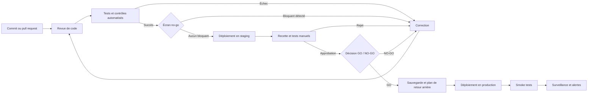

# Workflow de déploiement

Ce workflow fournit une séquence générique. Ajustez-le au niveau de risque et à l’architecture du projet.

## Écran de conditions bloquantes (no-go)

Vérification **obligatoire** avant de passer en staging. Un seul point suffit à stopper le déploiement :

| # | Condition bloquante | Vérifié |
|---|---------------------|:-------:|
| 1 | Aucun secret, clé API ou mot de passe dans le dépôt ni exposé côté client | ☐ |
| 2 | Mots de passe hachés ; contrôle d’accès appliqué côté serveur | ☐ |
| 3 | HTTPS partout, sans contenu mixte | ☐ |
| 4 | Aucune injection SQL possible (requêtes paramétrées sur les entrées utilisateur) | ☐ |
| 5 | Sauvegarde récente **et** test de restauration à jour ; plan de retour arrière documenté | ☐ |
| 6 | Données personnelles : politique de confidentialité, base légale, mécanisme d’effacement en place | ☐ |
| 7 | (E-commerce / SaaS) Flux de paiement testé ; clé secrète de paiement jamais exposée | ☐ |
| 8 | Erreurs détaillées (stack traces) désactivées en production | ☐ |

> Ces conditions reprennent les P0 de la checklist complète. Un **P0 non conforme ou bloqué = NO-GO**.

## Avant le déploiement

- vérifier les changements et leurs migrations ;
- confirmer que les secrets proviennent bien de l’environnement cible ;
- exécuter les tests, linters et contrôles de dépendances ;
- vérifier les sauvegardes et la procédure de restauration ;
- préparer une procédure de retour arrière ;
- confirmer les changements DNS, certificats et variables de configuration nécessaires.

## Décision GO / NO-GO

Documenter la décision (dans le ticket de release, le rapport d’audit, ou `docs/modele-audit.md` §7) :

| Champ | Valeur |
|-------|--------|
| Décision | [GO / NO-GO / GO avec réserves] |
| Écran no-go | ☐ Aucun bloquant / ☐ Bloquant(s) : [lequel] |
| P1 ouverts acceptés | [liste, ou « aucun »] |
| Risques acceptés | [liste, ou « aucun »] |
| Décideur | [nom / rôle] |
| Date | […] |
| Prochaine réévaluation | [date ou événement] |

## Après le déploiement

- exécuter un test fonctionnel minimal sur les parcours critiques ;
- vérifier les logs, erreurs 4xx/5xx, latence et disponibilité ;
- contrôler les paiements, emails et intégrations externes si concernés ;
- surveiller les métriques pendant la période post-déploiement ;
- documenter l’incident et la décision de retour arrière en cas de régression.
