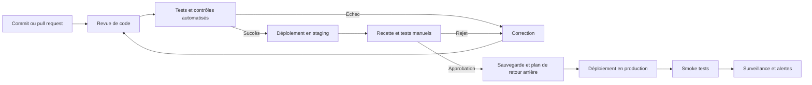

# Workflow de déploiement

Ce workflow fournit une séquence générique. Ajustez-le au niveau de risque et à l’architecture du projet.

## Avant le déploiement

- vérifier les changements et leurs migrations ;
- confirmer que les secrets proviennent bien de l’environnement cible ;
- exécuter les tests, linters et contrôles de dépendances ;
- vérifier les sauvegardes et la procédure de restauration ;
- préparer une procédure de retour arrière ;
- confirmer les changements DNS, certificats et variables de configuration nécessaires.

## Après le déploiement

- exécuter un test fonctionnel minimal sur les parcours critiques ;
- vérifier les logs, erreurs 4xx/5xx, latence et disponibilité ;
- contrôler les paiements, emails et intégrations externes si concernés ;
- surveiller les métriques pendant la période post-déploiement ;
- documenter l’incident et la décision de retour arrière en cas de régression.
